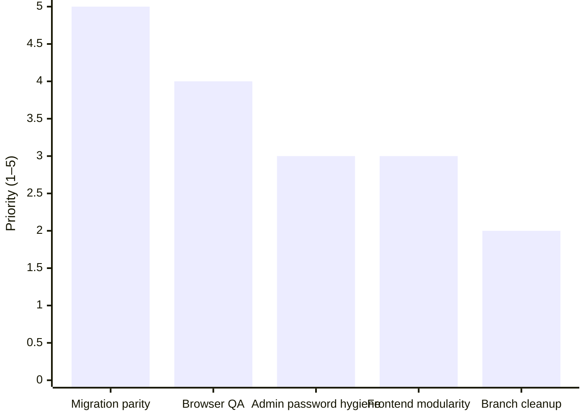

# FIWS Portal — project-wide quality audit

**Audit date:** 26 November 2026  
**Repository baseline:** `main` at `72ce4896ecb1749eb67f80f18962777df9f63b7d`  
**Scope:** GitHub repository, static-site build and CI, frontend structure/styles/animations, Supabase production schema and migration history, deployed Edge Functions, Supabase advisors and recent service logs.

This is a code/configuration and live-backend audit. It is **not** a claim of exhaustive browser/device QA: no interactive browser session, mobile-device matrix, screen-reader run or visual screenshot comparison was available during this pass.

## Executive assessment

FIWS is a feature-rich and operationally active static portal. The core architecture is viable for a small league: a single-page frontend, workbook-driven results, GitHub Pages hosting, and a Supabase backend for shared settings, applications and custom administrator workflows. The backend has several good security controls: RLS is enabled, privileged tables are not client-readable, administrator passwords are Argon2id-hashed, TOTP secrets are encrypted, recovery/session tokens are hashed, and critical recovery/account operations use database transactions.

The biggest weakness is not a single broken page. It is **operational drift and verification depth**: production contains migration/function state that is not fully represented by the repository, while CI checks syntax and static contracts but does not exercise the real UI in a browser.

## Findings and actions

### Fixed in the audit branch

1. **Application-function CORS source drift.** The production `submit-application` function allowed `https://fiws.devs.surf`, but the checked-in function source only allowed GitHub Pages and localhost. Production requests currently succeeded, but a future redeploy from the repository could have removed the custom-domain origin. The source allowlist is now aligned with production and covered by a regression test.
2. **Untracked retired Edge Function.** Production had an active `bootstrap-fiws-admins` function that intentionally returns HTTP 410, but no corresponding source file or CI type-check. The retired implementation is now checked in and validated, so the repository reflects the deployed function inventory.
3. **Outdated spreadsheet parser.** The frontend loaded SheetJS 0.18.5 from cdnjs. SheetJS identifies 0.20.3 as its current release and documents that older npm/CDN mirrors may be stale. The official 0.20.3 browser build is now pinned, and CI smoke-tests it against the actual bundled workbook before accepting the change.
4. **Ambiguous workbook selection.** The build script previously silently selected the first sorted workbook. It now fails clearly if the default data directory contains zero or multiple workbooks, and validates an explicitly supplied workbook path.
5. **Missing project onboarding documentation.** A root README now documents architecture, local preview, tests, deployment and the migration-drift warning.

### Production migration history — unresolved, high priority

The production database reports 24 applied migrations. The repository contains 21 migration files, and the versions do not match one-to-one. Production-only history entries absent from the repository include:

- `20261122175630 fiws_totp_replay_protection`
- `20261122193044 grant_service_role_application_workflow_access`
- `20261124211457 fix_multi_owner_unique_owner_index`

Several checked-in migration files also have different timestamps from the applied production versions despite sharing migration names:

| Checked-in version | Production version |
|---|---|
| `20261122183000` | `20261122185242` |
| `20261122184500` | `20261122185244` |
| `20261122190000` | `20261122185246` |
| `20261122191500` | `20261122185248` |
| `20261122194031` | `20261122194105` |
| `20261124220000` | `20261124210752` |

This may reflect manual migration repair, renamed files, or migrations applied outside the current source history. The live schema is healthy, but the repository cannot yet be treated as a fully reproducible database history. **Do not blindly run `supabase db push` or replay these migrations in a fresh environment.** First reconcile each production version to its exact SQL, restore missing migration files, determine whether the local newer migration was ever applied, then validate the migration list in a disposable Supabase branch/database before changing production.

### Verification results from the live Supabase project

- Project status: `ACTIVE_HEALTHY`; PostgreSQL 17.
- All 11 listed public tables have RLS enabled.
- Application and administrator-private tables have no `anon` or `authenticated` SELECT privileges; the service role has the expected backend access.
- The Supabase security advisor reports 9 informational `RLS Enabled No Policy` findings. The live grants show these tables are inaccessible to client roles; the absence of policies is an intentional service-role-only design, not evidence of public exposure.
- The security advisor also reports leaked-password protection disabled for Supabase Auth. FIWS administrator accounts currently use a custom password system rather than Supabase Auth, so this setting does not automatically protect those custom passwords. Consider a breached-password check for the custom admin flow or migrate it to Supabase Auth.
- The performance advisor reports four unused indexes. Given the current small tables, this is informational; do not drop them without query-volume and query-plan evidence.
- The health advisor returned no findings.
- Recent function-edge logs showed 153 HTTP 200 responses, one HTTP 201 and two HTTP 401 responses. No 403, 429 or 5xx statuses appeared in that sample; the two 401 responses were unauthorized requests.
- Recent Postgres error-log query and function error-log query returned no entries.

### Frontend and visual quality

- The main application template is approximately 385 KB, with roughly 107 KB of inline CSS and 261 KB of inline application JavaScript. This is manageable at present, but the single-file application is becoming difficult to review and safely extend.
- The source template and generated page are both committed. CI checks generated output on pull requests and compares the inline application script.
- Static inspection found 21 declared CSS keyframes, all referenced by styles, and 12 reduced-motion media-query blocks. That is a good baseline, but it does not prove every animation is visible or replayable in every browser/state.
- The recent championship dropdown required a dedicated repeatable open/close controller. This illustrates why CSS-only source assertions are insufficient for animation QA.
- The site has viewport/description/Open Graph/canonical/PWA metadata, a visible keyboard focus style, a skip link, and reduced-motion handling.
- There is no automated cross-browser visual regression, accessibility audit (axe), or viewport interaction suite. Responsive layouts, dropdowns, dialogs, admin flows, empty/error states and motion should be covered with browser-level tests.
- Some dynamic views are built with `innerHTML`. Continue using the shared escaping helper for every workbook, application and administrator-provided value; a future component/template layer would make this easier to enforce.

## Priority graph

Scores are review priorities, not measured defect counts. A 5 means the issue can block safe maintenance/deployment; a 1 is a low-risk polish opportunity.

## Recommended next improvements

1. **Reconcile migration history before any schema release.** This is the most important operational task.
2. **Add Playwright browser tests** for navigation, standings/driver history, dropdown open-close replay, reduced motion, dialogs, application submit/status, admin sign-in/MFA and responsive layouts at narrow/mobile/tablet/desktop widths.
3. **Add automated accessibility checks** (axe-core) and keyboard-only smoke tests; review contrast and accessible names for icon-only controls.
4. **Split the frontend into maintainable modules** (data/workbook parsing, rendering, navigation, admin, forms, theme and motion) while preserving the static deployment model. Add a bundler only if modularization justifies it.
5. **Harden custom admin password screening** with breached-password detection and review the password policy/session expiry periodically.
6. **Add supply-chain integrity controls** for CDN scripts (SRI or vendored pinned assets), and a scheduled dependency/security review.
7. **Clean up stale Git branches and review requests** after confirming they are not needed. The open Pocket Grand Prix PR #47 is based on an older pre-reset commit, is not mergeable, and targets a prototype directory that is intentionally absent from the current site; it should not be merged without a separate decision.
8. **Add deployment observability**: a post-deploy smoke check for the public site, manifest, critical assets and function CORS preflight from the canonical origin.

## Limits and items not changed

- No database schema or production data was modified.
- No production Edge Function was redeployed; only repository source was synchronized to the already-deployed implementation.
- No stale PR or branch was closed/deleted.
- No live visual/browser/device test was performed, so the report does not claim that every layout or animation has been visually verified.
- GitHub branch-protection settings could not be read with the current repository integration permissions.
