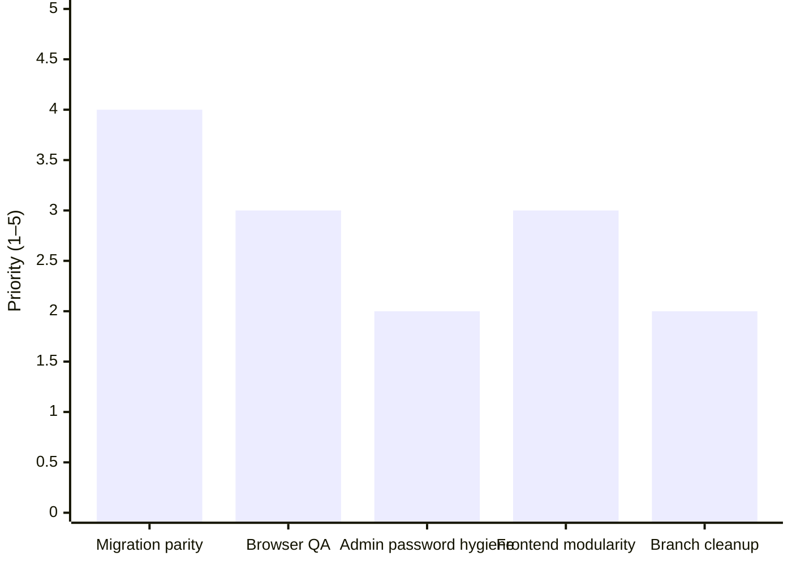

# FIWS Portal — project-wide quality audit

**Audit date:** 26 November 2026  
**Repository baseline:** `main` at merged release `92a8312976c5b9af500ccea8cce491c77d0ab0e6`  
**Scope:** GitHub repository, static-site build and CI, frontend structure/styles/animations, Supabase production schema and migration history, deployed Edge Functions, Supabase advisors and recent service logs.

This is a code/configuration and live-backend audit. It is **not** a claim of exhaustive browser/device QA: no interactive browser session, mobile-device matrix, screen-reader run or visual screenshot comparison was available during this pass.

## Executive assessment

FIWS is a feature-rich and operationally active static portal. The core architecture is viable for a small league: a single-page frontend, workbook-driven results, GitHub Pages hosting, and a Supabase backend for shared settings, applications and custom administrator workflows. The backend has several good security controls: RLS is enabled, privileged tables are not client-readable, administrator passwords are Argon2id-hashed, TOTP secrets are encrypted, recovery/session tokens are hashed, and critical recovery/account operations use database transactions.

The biggest remaining weakness is **verification depth**: the migration history is now represented in source, but reconstructed SQL still needs disposable-branch validation; browser coverage is now present but remains a focused Chromium smoke suite rather than full cross-browser and admin-flow coverage.

## Findings and actions

### Fixed in the audit branch

1. **Application-function CORS source drift.** The production `submit-application` function allowed `https://fiws.devs.surf`, but the checked-in function source only allowed GitHub Pages and localhost. Production requests currently succeeded, but a future redeploy from the repository could have removed the custom-domain origin. The source allowlist is now aligned with production and covered by a regression test.
2. **Untracked retired Edge Function.** Production had an active `bootstrap-fiws-admins` function that intentionally returns HTTP 410, but no corresponding source file or CI type-check. The retired implementation is now checked in and validated, so the repository reflects the deployed function inventory.
3. **Outdated spreadsheet parser.** The frontend loaded SheetJS 0.18.5 from cdnjs. SheetJS identifies 0.20.3 as its current release and documents that older npm/CDN mirrors may be stale. The official 0.20.3 browser build is now pinned, and CI smoke-tests it against the actual bundled workbook before accepting the change.
4. **Ambiguous workbook selection.** The build script previously silently selected the first sorted workbook. It now fails clearly if the default data directory contains zero or multiple workbooks, and validates an explicitly supplied workbook path.
5. **Missing project onboarding documentation.** A root README now documents architecture, local preview, tests, deployment and the migration-drift warning.
6. **Untracked Edge Function authentication settings.** Production has `verify_jwt=false` for the two custom-auth/public functions and `true` for the retired bootstrap function, but the repository had no `supabase/config.toml`. The explicit project/function configuration is now checked in and covered by a regression test, preventing accidental default-JWT behavior on redeploy.

### Production migration history — reconciled in source; disposable-branch verification remains

The live production ledger contains 24 migration versions. The follow-up branch restores the repository's production-version filenames and adds the two previously missing migration records. The 24 production versions now have matching checked-in SQL files:

- `20261122193044` restores the verified service-role CRUD grants on `public.applications` and `public.application_ip_limits`.
- `20261124211457` removes the old `fiws_single_owner_uq` partial unique index. The current production catalog has no such index, and the original admin-identity migration creates it; the later multi-owner migration therefore needs this explicit drop.
- Six checked-in filenames were corrected to their production-applied versions: `183000 → 185242`, `184500 → 185244`, `190000 → 185246`, `191500 → 185248`, `194031 → 194105`, and `24220000 → 24210752`.
- The TOTP replay-protection migration `20261122175630` was already present in the repository and matches production; it is not a missing migration.

One additional, intentionally pending local migration, `20261126162000_grant_service_role_execute_fiws_admin_check.sql`, records the service-role EXECUTE grant for `private.is_fiws_admin()`. The live catalog already has this privilege, but it was not represented in the production migration ledger. The migration is idempotent and is versioned after the production history so the next deliberate migration push can record it without replaying older timestamps.

The two restored production migrations are reconstructed from the live catalog and current application access model; they are not claimed to be byte-for-byte copies of the original historical SQL. The reconciliation test now locks the exact 24 production versions plus the one pending local migration and checks the critical grant/index statements. **Before any production `supabase db push`, validate the reconstructed SQL against a disposable Supabase branch/database and inspect the resulting schema diff.** No production SQL, schema, or data was changed during this reconciliation.

See [the migration reconciliation record](MIGRATION_RECONCILIATION.md) for the version map, evidence, and safe rollout sequence.

### Verification results from the live Supabase project

- Project status: `ACTIVE_HEALTHY`; PostgreSQL 17.
- All 11 listed public tables have RLS enabled.
- Application and administrator-private tables have no `anon` or `authenticated` SELECT privileges; the service role has the expected backend access.
- The Supabase security advisor reports 9 informational `RLS Enabled No Policy` findings. The live grants show these tables are inaccessible to client roles; the absence of policies is an intentional service-role-only design, not evidence of public exposure.
- The security advisor also reports leaked-password protection disabled for Supabase Auth. FIWS administrator accounts use a custom password system rather than Supabase Auth, so that setting does not protect those credentials. The administrator password-set paths now perform Have I Been Pwned Pwned Passwords k-anonymity screening: the Edge Function hashes locally and sends only the first five SHA-1 characters with response padding; neither the raw password nor the full hash is transmitted. A lookup outage fails closed with HTTP 503.
- The performance advisor reports four unused indexes. Given the current small tables, this is informational; do not drop them without query-volume and query-plan evidence.
- The health advisor returned no findings.
- Recent function-edge logs showed 153 HTTP 200 responses, one HTTP 201 and two HTTP 401 responses. No 403, 429 or 5xx statuses appeared in that sample; the two 401 responses were unauthorized requests.
- Recent Postgres error-log query and function error-log query returned no entries.

### Frontend and visual quality

- The main application template is approximately 385 KB, with roughly 107 KB of inline CSS and 261 KB of inline application JavaScript. This is manageable at present, but the single-file application is becoming difficult to review and safely extend.
- The source template and generated page are both committed. CI checks generated output on pull requests and compares the inline application script.
- Static inspection found 21 declared CSS keyframes, all referenced by styles, and 12 reduced-motion media-query blocks. That is a good baseline, but it does not prove every animation is visible or replayable in every browser/state.
- The recent championship dropdown required a dedicated repeatable open/close controller. Chromium browser tests now exercise repeated open/close/reopen behavior with a deterministic championship-details fixture, plus the driver-season picker when the workbook exposes a driver profile link.
- The site has viewport/description/Open Graph/canonical/PWA metadata, a visible keyboard focus style, a skip link, and reduced-motion handling.
- CI now runs a Chromium browser suite against the generated static site, covering primary navigation, repeated championship dropdown motion, the driver-season picker when available, common viewport overflow, and critical axe accessibility violations. This is a focused smoke suite, not a full visual-regression or admin-authentication test matrix; Firefox/WebKit, screenshot baselines, keyboard-only flows and the complete admin lifecycle remain follow-ups.
- Some dynamic views are built with `innerHTML`. Continue using the shared escaping helper for every workbook, application and administrator-provided value; a future component/template layer would make this easier to enforce.

## Priority graph

Scores are review priorities, not measured defect counts. A 5 means the issue can block safe maintenance/deployment; a 1 is a low-risk polish opportunity.

## Recommended next improvements

1. **Validate the reconstructed migration history in a disposable Supabase branch before any schema release.** Source version parity is now restored, but the two recovered SQL files need a clean-branch schema-diff check before production use.
2. **Expand Playwright coverage** to Firefox/WebKit, reduced-motion assertions, dialogs, application submit/status, admin sign-in/MFA, keyboard-only flows and screenshot baselines.
3. **Expand accessibility coverage** beyond the current critical-only axe scan: fail on serious violations after remediation, add keyboard-only smoke tests, and review contrast and accessible names for icon-only controls.
4. **Split the frontend into maintainable modules** (data/workbook parsing, rendering, navigation, admin, forms, theme and motion) while preserving the static deployment model. Add a bundler only if modularization justifies it.
5. **Review custom admin password policy and session expiry periodically**, and consider managed authentication if the operational burden of custom auth, MFA and recovery becomes too high.
6. **Maintain supply-chain integrity controls**: the pinned SheetJS 0.20.3 CDN script now carries a SHA-384 SRI hash; consider vendoring it if CDN availability becomes a concern, and schedule dependency/security reviews.
7. **Clean up stale Git branches and review requests** after confirming they are not needed. The open Pocket Grand Prix PR #47 is based on an older pre-reset commit, is not mergeable, and targets a prototype directory that is intentionally absent from the current site; it should not be merged without a separate decision.
8. **Add deployment observability**: a post-deploy smoke check for the public site, manifest, critical assets and function CORS preflight from the canonical origin.

## Limits and items not changed

- No database schema or production data was modified. Migration source files were reconciled against read-only production catalog evidence.
- No production Edge Function was redeployed; only repository source was synchronized to the already-deployed implementation.
- No stale PR or branch was closed/deleted.
- CI now performs Chromium browser interaction and axe smoke tests against the generated site. No independent live-site browser/device inspection or screenshot comparison was performed, so the report does not claim every deployed layout or animation has been visually verified.
- GitHub branch-protection settings could not be read with the current repository integration permissions.
